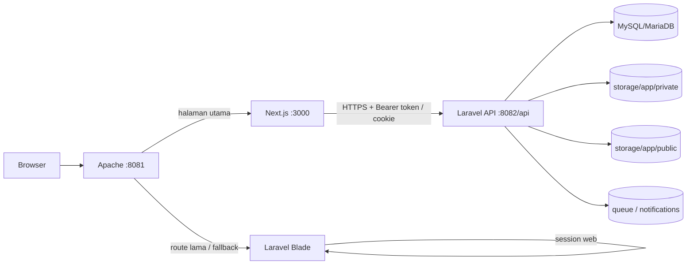

# Arsitektur

## Gambaran besar

JURI.ON memakai arsitektur **API-first** dengan dua frontend:



- **Next.js** adalah antarmuka utama untuk admin, peserta, juri, dan halaman publik.
- **Laravel** menyediakan API, autentikasi, otorisasi, validasi, penyimpanan file, dan halaman Blade legacy.
- **Sanctum** menangani token API. Next.js membaca cookie `jl_token` lalu mengirim `Authorization: Bearer <token>` ke Laravel.
- Halaman publik memakai API publik tanpa token.

## Request flow utama

### Halaman terautentikasi

1. Browser meminta halaman Next.js.
2. Server Component Next.js membaca cookie `jl_token`.
3. `apiFetch()` memanggil Laravel API dengan Bearer token.
4. Laravel memvalidasi token, status user, role, dan scope event.
5. Respons JSON dirender menjadi halaman.

Jika token tidak ada/kedaluwarsa, Next.js redirect ke `/login`.

### Aksi mutasi (form)

1. Form memanggil Server Action Next.js.
2. Server Action mengirim request ke API memakai cookie token.
3. API memvalidasi input dan otorisasi.
4. Server Action menerjemahkan error API menjadi pesan form.
5. `revalidatePath()` / `router.refresh()` memperbarui data.

### Halaman publik

1. Next.js memanggil endpoint `/api/public/*` tanpa token.
2. Laravel hanya mengembalikan event yang berstatus `active` dan tidak diarsipkan.
3. Event dengan slug dapat diakses melalui `/events/{slug}`.

## Struktur backend

| Path | Tanggung jawab |
|---|---|
| `routes/web.php` | Route Blade legacy: dashboard, event, form, juri, pembayaran |
| `routes/api/public.php` | Event publik, detail by ID/slug |
| `routes/api/auth.php` | Register, login, reset password, logout |
| `routes/api/admin.php` | Semua operasi Admin Event / Admin Owner |
| `routes/api/jury.php` | Undangan, penilaian, revisi |
| `routes/api/participant.php` | Pendaftaran, pembayaran, hasil, file |
| `routes/api/owner.php` | Manajemen pengguna global |
| `routes/api/profile.php` | Profil, password, profil juri |
| `routes/api/chat.php` | Chat event, moderasi, laporan |
| `app/Http/Middleware/CheckRole.php` | Pemeriksaan role |
| `app/Http/Middleware/EnsureUserIsActive.php` | Blokir akun nonaktif |
| `app/Http/Middleware/SecurityHeaders.php` | Header keamanan web |
| `app/Services/EventQuotaService.php` | Kuota 3 event + lock transaksi |
| `app/Services/AuditLogger.php` | Penulisan audit log |
| `app/Models/Event.php` | Aturan status, registrasi, scoring, slug |
| `app/Models/User.php` | Role helper, scope, assignment, entitlement |

## Struktur frontend

```text
my-app/src/
├── app/
│   ├── admin/            # Dashboard, event, participants, payments, scores, chat
│   ├── jury/             # Undangan, event, form penilaian, leaderboard, revisi
│   ├── events/           # Halaman publik + pendaftaran + chat
│   ├── registrations/    # Detail pendaftaran, pembayaran, hasil
│   ├── profile/          # Profil umum + profil juri
│   ├── owner/            # Manajemen pengguna
│   └── actions/routes    # Server Actions dan route handler download
├── components/
│   ├── admin/            # Builder form, onboarding juri, tabel, kontrol
│   ├── participant/      # Komponen peserta
│   ├── public/           # Halaman publik, kartu event, shell
│   ├── arc/              # Komponen UI dasar
│   └── kit/              # Card, Badge, Table, PageHeader
└── lib/                  # apiFetch, navigasi, format, util
```

## Model otorisasi

Otorisasi berlapis:

1. **Autentikasi** — token Sanctum / session.
2. **Status akun** — `is_active`; akun nonaktif tidak boleh masuk.
3. **Role** — `admin_owner`, `admin`, `jury`, `participant`.
4. **Scope event** — `event_scope=all` atau `own` untuk admin.
5. **Kepemilikan resource** — peserta hanya data sendiri; juri hanya skor sendiri; admin hanya event yang dikelola.
6. **Guard domain** — mis. hanya juri yang boleh mengubah skor; admin harus meminta revisi.

Detail matriks: [roles-permissions.md](roles-permissions.md).

## Penyimpanan file

| Disk | Root | Isi | Akses |
|---|---|---|---|
| `local` | `storage/app/private` | Bukti pembayaran, dokumen peserta | Lewat route ber-otorisasi |
| `public` | `storage/app/public` | Banner, juknis, logo organizer | URL publik setelah `storage:link` |

Aturan:

- Jangan memindahkan dokumen peserta/bukti bayar ke disk publik.
- Nama file asli disimpan di database; path internal tidak diekspos ke publik.
- Route download memeriksa pemilik atau admin event.

## Latar belakang & notifikasi

- Notifikasi undangan juri, permintaan revisi, dan hasil respons memakai Laravel database notifications.
- Queue default `database`; konfigurasi produksi dapat memakai worker terpisah.
- Email default `log`; integrasi SMTP perlu diatur untuk produksi.

## Keputusan teknis penting

| Keputusan | Alasan |
|---|---|
| Next.js di atas API Laravel | Pemisahan UI/backend, halaman publik cepat, komponen interaktif |
| Blade tetap dipertahankan | Kompatibilitas route lama dan test regresi |
| Sanctum token di cookie httpOnly | Token tidak dapat dibaca JavaScript halaman |
| Skor hanya boleh diubah juri | Menjaga integritas penilaian; admin melalui revisi |
| Kuota dengan row lock | Menghindari over-booking event saat request paralel |
| Snapshot form pada skor | Perubahan template tidak mengubah konteks historis |
| Publikasi terpisah dari skor | Peserta hanya melihat evaluasi yang sudah direview |
| File privat di disk `local` | Dokumen sensitif tidak dapat diakses lewat URL publik |
| Slug + ID tetap didukung | Kompatibilitas link lama dan link publik baru |

## Batasan saat ini

- Kategori/cabang per event belum menjadi entitas tersendiri; masih memakai kategori global.
- Lifecycle event belum delapan tahap penuh; status saat ini `draft`, `active`, `closed`, `completed`, plus arsip.
- Integrasi WhatsApp masih berupa tautan grup dan consent, bukan WhatsApp Business API.
- Belum ada halaman audit log khusus; data audit tersimpan di tabel.
- Builder juri belum mendukung bobot/rubrik kompleks secara visual; snapshot kriteria sudah disimpan per skor.

Batasan ini juga dicatat di [features.md](features.md).
