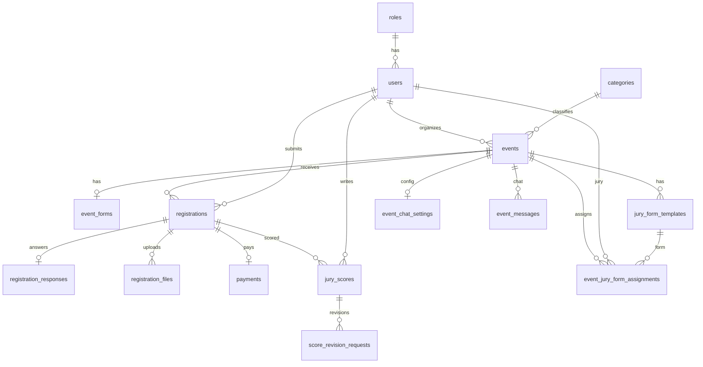

# Database

## Ringkasan

Database produksi memakai MySQL/MariaDB. Test memakai SQLite in-memory. Skema dikelola lewat migration Laravel di `database/migrations`.

Tabel utama:

```text
roles, users
categories, events, event_forms, event_jury_form_assignments, jury_form_templates
registrations, registration_responses, registration_files, payments
jury_scores, score_revision_requests
custom_event_form_templates, custom_jury_form_templates
organizer_profiles, organizer_entitlements
event_chat_settings, event_messages
audit_logs, notifications
sessions, cache, jobs, personal_access_tokens
```

## Relasi inti



## Tabel penting

### `users`

| Kolom | Catatan |
|---|---|
| `role_id` | FK ke `roles` |
| `event_scope` | `all` atau `own` untuk admin |
| `is_active` | Akun nonaktif diblokir middleware |
| `created_by` | Admin pembuat akun juri |
| `phone`, `organization`, `expertise`, `bio` | Profil juri |
| `whatsapp_number`, `whatsapp_consent` | Kontak WA dan izin tampil |

Helper penting: `isAdminOwner()`, `isAdmin()`, `isEventAdmin()`, `canManageAllEvents()`, `canManageEvent()`, `hasAcceptedAssignmentFor()`.

### `events`

| Kolom | Catatan |
|---|---|
| `organizer_id` | Pembuat/pemilik event |
| `category_id` | Kategori global |
| `name`, `slug` | Slug unik untuk URL publik |
| `description`, `price`, `quota`, `registered_count` | Informasi pendaftaran |
| `format` | `offline`, `online`, `hybrid` |
| `participation_mode` | `individual` atau `team` |
| `team_min_members`, `team_max_members` | Batas anggota tim |
| `timezone` | Default `Asia/Jakarta` |
| `contact_name`, `contact_email`, `contact_phone` | Kontak panitia |
| `registration_start/end`, `event_date`, `event_start/end` | Jadwal |
| `status` | `draft`, `active`, `closed`, `completed` |
| `archived_at` | Arsip; event tidak tampil publik |
| `scoring_enabled` | `true`/`false`/`null` (auto hari H) |
| `banner`, `juknis_file`, `juknis_name` | Aset |
| `require_official_email`, `allowed_email_domains` | Validasi email peserta |
| `evaluations_published_at` | Waktu publikasi evaluasi |

Aturan:

- Registrasi hanya saat status `active`, belum diarsipkan, dalam periode, dan kuota tersedia.
- `registered_count` dinaikkan dalam transaksi dengan row lock.
- Kuota organizer dihitung dari seluruh event dengan `organizer_id` yang sama, termasuk draft/arsip.

### `registrations`

| Kolom | Catatan |
|---|---|
| `registration_number` | Nomor unik |
| `team_name`, `team_members` | JSON anggota tim |
| `status` | `pending`, `verified`, `rejected`, `cancelled` |
| `registered_at` | Waktu daftar |

Relasi: `response`, `files`, `payment`, `juryScores`.

### `registration_files`

Menyimpan metadata dokumen privat:

| Kolom | Catatan |
|---|---|
| `field_label` | Label field form |
| `path` | Path disk `local` |
| `original_name`, `mime_type`, `size` | Metadata |
| `uploaded_by` | User pengunggah |

File hanya dapat diunduh lewat route ber-otorisasi.

### `jury_form_templates`

Form penilaian milik event:

| Kolom | Catatan |
|---|---|
| `event_id` | Satu event dapat punya banyak form |
| `name` | Nama form/posisi |
| `criteria_fields` | JSON kriteria |
| `use_default_score` | Jumlahkan skor otomatis |

Tipe field: `score`, `text`, `textarea`, `select`. Field skor punya `max`.

### `custom_jury_form_templates`

Template custom lintas event yang dibuat admin:

| Kolom | Catatan |
|---|---|
| `name`, `description` | Identitas template |
| `criteria_fields` | JSON kriteria |
| `use_default_score` | |
| `created_by` | Pemilik template |

Dipakai oleh halaman form juri untuk “Gunakan” dan “Simpan sebagai Template”.

### `event_jury_form_assignments`

| Kolom | Catatan |
|---|---|
| `event_id`, `jury_id` | Unik per pasangan |
| `jury_form_template_id` | Form yang dinilai |
| `jury_role` | Label posisi, mis. “Juri Vokal” |
| `status` | `pending`, `accepted`, `declined` |
| `responded_at` | Waktu respons |

Assignment baru mengirim notifikasi undangan.

### `jury_scores`

| Kolom | Catatan |
|---|---|
| `registration_id`, `jury_id` | Unik per juri/peserta |
| `jury_form_template_id` | Form saat menilai |
| `score` | Nilai total |
| `public_feedback` | Terlihat peserta setelah publish |
| `private_evaluation` | Internal |
| `criteria_responses` | Snapshot jawaban per label |
| `form_snapshot` | Snapshot form saat skor dibuat |
| `status` | `submitted`, `reviewed`, `published`, `needs_revision` |
| `submitted_at`, `published_at` | |
| `reviewed_by`, `reviewed_at`, `review_notes` | Review admin |

Aturan:

- Hanya juri pemilik yang boleh mengubah.
- Perubahan skor mengembalikan status ke `submitted` dan mencabut publikasi.
- Publikasi hanya setelah review admin dan tidak ada revisi pending.

### `score_revision_requests`

| Kolom | Catatan |
|---|---|
| `jury_score_id`, `event_id` | |
| `requested_by`, `jury_id` | Admin dan juri tujuan |
| `reason` | Alasan wajib |
| `status` | `pending`, `applied`, `rejected`, `cancelled` |
| `resolution_notes`, `resolved_by`, `resolved_at` | |

Permintaan baru membatalkan permintaan pending sebelumnya untuk skor yang sama.

### `payments`

| Kolom | Catatan |
|---|---|
| `registration_id` | Unik |
| `amount` | Mengikuti harga event |
| `proof_file` | Path disk privat |
| `status` | `pending`, `verified`, `rejected` |
| `verified_by`, `verified_at`, `verification_notes` | |

### `organizer_profiles`, `organizer_entitlements`

- Profil organizer: identitas publik dan kontak.
- Entitlement: batas event per user (`event_limit`), fitur, masa berlaku.
- Backfill memberi Admin Event limit 3; Admin Owner tanpa batas.

### `event_chat_settings`, `event_messages`

- Setting per event: enabled, izin kirim peserta/juri, WhatsApp link, pengumuman.
- Pesan: pengirim, body, hidden/reported untuk moderasi.

### `audit_logs`

| Kolom | Catatan |
|---|---|
| `actor_id` | Pelaku |
| `action` | Contoh `evaluation.published`, `score.revision_requested` |
| `auditable_type/id` | Resource |
| `metadata` | JSON konteks |
| `ip_address`, `user_agent` | |

## Migrasi

Aturan:

1. Jangan mengubah migration yang sudah pernah dijalankan produksi; buat migration baru.
2. Sertakan backfill data bila menambah kolom wajib.
3. Uji `migrate:fresh --seed` dan `migrate` pada database existing.
4. Untuk perubahan enum/status, pertimbangkan constraint SQLite saat test.

Perintah:

```bash
php artisan migrate
php artisan migrate:status
php artisan migrate:fresh --seed   # hanya development
```

## Backup & restore

```bash
mysqldump -u USER -p jurionline > backup-jurionline-$(date +%F).sql
mysql -u USER -p jurionline < backup-jurionline-YYYY-MM-DD.sql
```

Backup juga:

- `storage/app/private` (dokumen sensitif)
- `storage/app/public` (banner/juknis)
- `.env` produksi (di luar repo)

## Integritas data

- Hapus event belum otomatis menghapus file fisik di storage; lakukan maintenance saat menghapus.
- Arsip event tidak menghapus data dan tetap dihitung kuota.
- Skor historis bergantung pada `form_snapshot`; jangan menghapus snapshot saat membersihkan data.
- Audit log sebaiknya retensi minimal 1 tahun sesuai kebijakan event.
